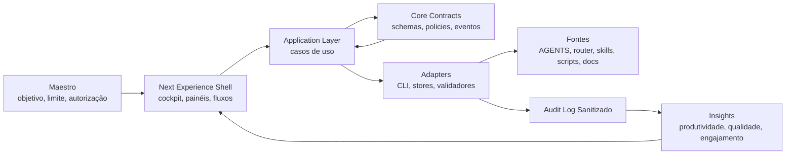
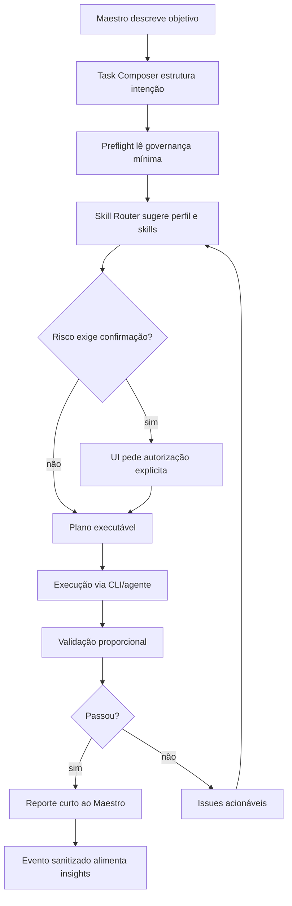
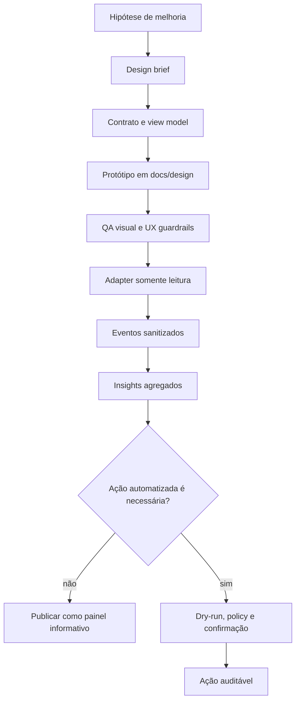

# Arquitetura Next Experience

Este documento propõe uma camada de experiência operacional para o
Orquestrador Maestro. O objetivo não é trocar a governança por uma interface
visual, mas tornar regras, skills, validações, execuções e insights mais
visíveis, acionáveis e fáceis de evoluir.

## Objetivo

A Next Experience deve funcionar como um cockpit do Maestro:

- reduzir prompts repetitivos;
- explicitar a próxima ação segura;
- mostrar riscos antes de execução;
- medir uso real de skills, contexto e validações;
- acelerar instalação, diagnóstico, atualização e publicação;
- preservar o contrato público, auditável e sanitizado do repositório.

## Princípios

- Contratos antes de telas.
- View models antes de APIs.
- Telemetria sanitizada antes de insights.
- Painel somente leitura até existir contrato auditável para ações.
- Integrações reais desligadas por padrão.
- Nenhum token, caminho privado, log sensível ou memória local entra no
  snapshot publicável.
- A interface orienta o Maestro; a governança continua sendo a fonte de verdade.

## Boundaries

Permitido:

```text
docs/design          -> protótipos estáticos e componentes de apresentação
interfaces/panel     -> view models e leitura de estado sanitizado
interfaces/cli       -> comandos, diagnóstico e validação
application          -> casos de uso e orquestração
core/contracts       -> schemas, policies e eventos puros
infrastructure/local -> leitura local, audit log e stores versionados
```

Proibido:

```text
panel -> arquivos privados locais diretamente
panel -> scripts sem adapter
panel -> secrets, logs brutos ou payloads completos
api -> .omx sem policy/redaction
core -> infrastructure
insights -> eventos não classificados
actions -> execução sem dry-run e confirmação quando houver risco
```

## Visão De Sistema



## Componentes De Produto

| Componente | Função | Fonte inicial |
|---|---|---|
| Cockpit | Visão geral de prontidão, riscos e próxima ação. | `docs/design` |
| Task Composer | Constrói pedidos estruturados para a IA. | `AGENTS.md`, `docs/ai-agent-operating-guide.md` |
| Skill Router View | Mostra skill sugerida, custo, segurança e chains. | `SKILLS_ROUTER.json`, `SKILL_CHAINS.json` |
| Preflight Panel | Exibe governança lida, escopo, restrições e bloqueios. | `AGENTS.md`, `orquestrador/hooks.md` |
| Validation Center | Consolida validações, scripts e estado publicável. | `scripts/validate-public.ps1`, comandos CLI |
| Runs Timeline | Linha do tempo de execução sanitizada. | eventos auditáveis |
| Insight Radar | Métricas de uso, retrabalho, contexto e qualidade. | eventos agregados |
| Evolution Planner | Mostra ondas, PRs sugeridos e critérios de conclusão. | docs de arquitetura e planos |

## Contratos Mínimos

A Next Experience deve começar com contratos pequenos, versionados e testáveis:

| Contrato | Campos essenciais |
|---|---|
| `TaskIntent` | objetivo, escopo, risco, perfil, confirmação exigida |
| `SkillRouteResult` | skill principal, skills encadeadas, custo, motivo, guardrails |
| `PreflightState` | arquivos lidos, regras aplicadas, pendências, bloqueios |
| `ValidationResult` | comando, status, duração, issues, warnings, saída resumida |
| `RunRecord` | id sanitizado, timestamps, status, artefatos, validações |
| `AuditEvent` | tipo, classificação, payload redigido, origem, timestamp |
| `InsightSnapshot` | métricas agregadas, tendências, gargalos, recomendações |

Nenhum contrato deve depender de texto bruto de terminal, logs completos ou
caminhos privados. O dado sensível é bloqueado ou redigido antes de persistir.

## Fluxo De Aplicação



## Fluxo De Evolução



## Orquestração De Design

A evolução de UI/UX deve seguir quatro etapas:

1. **Descoberta operacional**: mapear a tarefa real do Maestro, o risco e a
   evidência de sucesso.
2. **Contrato**: definir view model, estados vazios, erros, bloqueios e eventos
   antes de desenhar a tela.
3. **Composição**: montar componentes reutilizáveis, densos e legíveis para uso
   repetido, priorizando scan rápido e ação clara.
4. **Validação**: checar responsividade, overflow, acessibilidade, contraste,
   estados de carregamento, estados sem dados e mensagens de bloqueio.

## Interação UI/UX

### Shell

- Sidebar com `Visão geral`, `Skills`, `Conectores`, `Execuções`, `Auditoria`,
  `Insights` e `Evolução`.
- Topbar com ambiente, última atualização, status de validação e ação de
  refresh.
- Conteúdo em painéis densos, com tabelas, listas, timelines e filtros.

### Padrões De Componente

| Padrão | Uso |
|---|---|
| Status pill | Estado compacto de validação, skill, conector ou execução. |
| Action row | Próxima ação com risco, pré-requisito e resultado esperado. |
| Timeline | Sequência de comandos, validações e eventos auditáveis. |
| Drawer de detalhe | Explica por que uma skill ou policy foi escolhida. |
| Empty state operacional | Mostra o próximo comando ou diagnóstico, sem texto promocional. |
| Diff summary | Resume impacto sem expor payload sensível. |
| Insight card | Mostra tendência, evidência e ação recomendada. |

### Estados Obrigatórios

- pronto;
- carregando;
- vazio;
- bloqueado por policy;
- erro recuperável;
- validação falhou;
- dado redigido;
- ação exige confirmação;
- modo somente leitura.

## Métricas E Insights

| Métrica | Pergunta respondida |
|---|---|
| Tempo até próxima ação | O Maestro sabe rapidamente o que fazer? |
| Skills roteadas por tarefa | O roteamento está reduzindo esforço? |
| Contexto aberto por execução | Há desperdício de leitura/token? |
| Validações falhas por área | Onde a qualidade quebra mais? |
| Bloqueios de segurança | Quais riscos aparecem com frequência? |
| Retrabalho por fluxo | Quais tarefas voltam para correção? |
| Comandos mais usados | O que merece virar atalho ou botão? |
| Tempo até conclusão | A experiência está aumentando produtividade? |

Todos os insights devem usar eventos agregados e sanitizados. Métricas
individuais só podem aparecer quando não expõem conteúdo privado.

## Roadmap De Construção

### Fase 1: Fundação

- Definir contratos `TaskIntent`, `PreflightState`, `ValidationResult`,
  `RunRecord`, `AuditEvent` e `InsightSnapshot`.
- Criar fixtures públicas com exemplos seguros.
- Criar view models estáticos para o painel atual em `docs/design`.

### Fase 2: Cockpit Somente Leitura

- Ligar o painel a fixtures públicas sanitizadas ou stores locais reais.
- Adicionar telas de `Insights` e `Evolução`.
- Exibir validações, skills e execuções sem executar ações pelo painel.

### Fase 3: Adapters Locais

- Criar adapter para comandos de validação e health.
- Persistir audit log local sanitizado.
- Adicionar agregador de métricas sem payload bruto.

### Fase 4: Ações Auditáveis

- Adicionar dry-run para ações de baixo risco.
- Exigir confirmação para sync, edição, publicação, integração externa ou ação
  destrutiva.
- Registrar resultado em eventos classificados.

### Fase 5: Evolução Inteligente

- Recomendar atalhos a partir de comandos recorrentes.
- Sugerir melhorias de skills com base em falhas e retrabalho.
- Comparar impacto de mudanças por ondas, PRs e critérios de conclusão.

## Critérios De Pronto

Uma entrega Next Experience só deve ser considerada pronta quando:

- contratos têm `schemaVersion`;
- fixtures são públicas e sanitizadas;
- UI tem estados de erro, vazio, bloqueio e redaction;
- ações perigosas não existem ou exigem dry-run e confirmação;
- o painel não acessa arquivos privados diretamente;
- validação pública passa;
- documentação indica o que é protótipo, contrato e implementação.

## Riscos

| Risco | Mitigação |
|---|---|
| Interface virar fonte de verdade paralela | Contratos e docs continuam canônicos. |
| Expor dados locais no painel | Redaction antes de persistência e renderização. |
| Automatizar ação arriscada cedo demais | Começar somente leitura; depois dry-run; depois confirmação. |
| Métricas virarem vigilância | Usar agregados sanitizados e foco em qualidade operacional. |
| Painel bonito sem utilidade | Cada componente precisa responder a uma decisão real do Maestro. |
