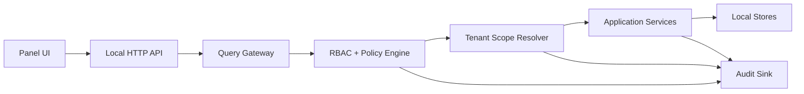
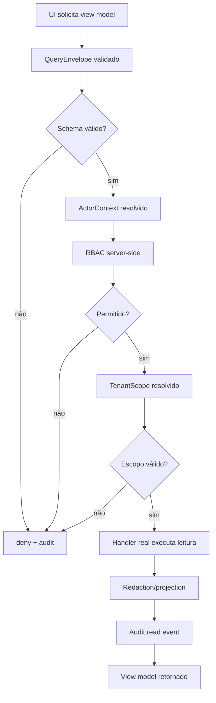
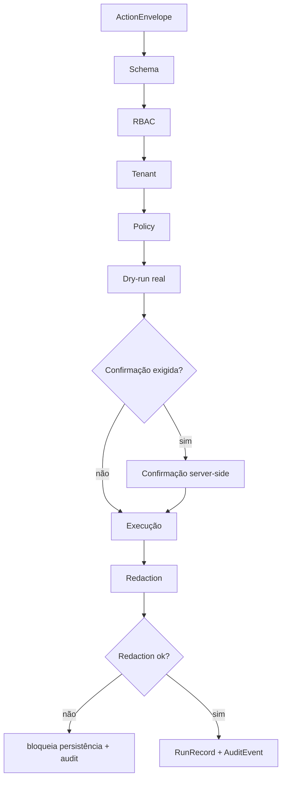

# Plano De Implementação Next Experience

Status: proposta arquitetural.

Este plano transforma a arquitetura Next Experience em uma sequência de PRs
curtos, reais e verificáveis. Ele assume uma regra rígida: não criar painel,
API ou automação que dependa de mocks, stubs, identificadores genéricos,
autorização client-side, acesso sem tenant ou comportamento fail-open.

## Regras Não Negociáveis

- **Sem mocks e sem stubs**: cada PR deve usar contratos reais, adapters reais,
  fixtures sanitizadas ou stores locais reais. Protótipos visuais podem existir
  em `docs/design`, mas não contam como implementação funcional.
- **Query-first**: toda leitura nasce de uma query explícita, validada e
  autorizada antes de tocar storage, arquivo ou processo.
- **RBAC server-side**: nenhum botão, rota ou componente decide permissão. A UI
  apenas reflete decisões retornadas pelo servidor/aplicação.
- **Tenant isolation**: toda entidade operacional tem escopo explícito de
  tenant/workspace/projeto antes de ser listada, lida, exportada ou agregada.
- **Fail-closed**: ausência de policy, role, tenant, classificação, schema,
  confirmação ou redaction bloqueia a operação.
- **Auditoria obrigatória**: toda negação, leitura sensível, validação, ação,
  export e erro relevante gera evento auditável sanitizado.
- **Identificadores tipados**: evitar `id`, `user`, `tenant`, `item` genéricos
  em contratos públicos. Usar nomes de domínio como `workspaceKey`,
  `projectKey`, `actorKey`, `runKey`, `skillSlug`, `auditEventKey`.
- **Sem dados crus no painel**: logs, paths locais, payloads, stdout/stderr e
  prompts completos nunca são enviados diretamente para UI.

## Arquitetura-Alvo



Dependency rule:

```text
panel -> http client -> query gateway -> application -> core contracts
application -> ports -> infrastructure
core -> pure validation only
```

Forbidden:

```text
panel -> store
panel -> scripts
http route -> file system
http route -> process execution
application -> unscoped list
insights -> raw audit payload
```

## Modelo De Autorização

### Escopos

| Escopo | Uso |
|---|---|
| `workspaceKey` | Instalação lógica do Orquestrador para uma área de trabalho. |
| `projectKey` | Repositório/projeto dentro do workspace. |
| `actorKey` | Ator local ou serviço autorizado. |
| `sessionKey` | Sessão local curta para painel/API. |
| `runKey` | Execução auditável e consultável. |

### Roles

| Role | Permissões |
|---|---|
| `maestro.owner` | Configura escopos, confirma ações sensíveis e lê auditoria. |
| `maestro.operator` | Executa validações e consulta runs do projeto autorizado. |
| `maestro.viewer` | Lê painel e insights agregados autorizados. |
| `service.validator` | Executa validações permitidas e grava eventos. |
| `service.panel` | Consulta view models, sem executar ações. |

Toda permissão deve ser avaliada server-side com:

```text
actorKey + role + workspaceKey + projectKey + action + resource + policy
```

Sem combinação completa, a resposta é `403 policy_denied` e um evento
`policy.denied` é gravado.

## Query-First Contract

Toda query deve ter este envelope:

```text
queryName
schemaVersion
workspaceKey
projectKey
actorKey
filters
pagination
fields
purpose
```

Regras:

- `workspaceKey`, `projectKey`, `actorKey` são obrigatórios.
- `filters` não pode ser vazio em listas operacionais grandes.
- `fields` deve limitar a projeção retornada.
- `purpose` precisa mapear para uma permissão de leitura.
- queries não podem executar processo, sync, migração ou escrita.
- ausência de índice/caminho de consulta aprovado bloqueia a leitura.

## Estratégia Sem Mocks

Permitido:

- fixtures públicas sanitizadas versionadas;
- stores locais reais em diretório temporário de teste;
- adapters reais com dependências locais disponíveis;
- testes de contrato contra arquivos reais do repositório;
- dry-run real que percorre o fluxo e não altera estado.

Proibido:

- substituir policy engine por retorno fixo;
- simular RBAC no client;
- painel consumir JSON hardcoded como se fosse API;
- endpoint retornar dados inventados;
- deixar TODO para isolamento, audit ou redaction;
- PR visual que finge integração funcional.

## Plano Multi-PR

### PR 0: Baseline E Travamento De Regras

Objetivo: registrar o estado atual e impedir regressão antes da implementação.

Escopo:

- adicionar este plano à documentação principal;
- criar checklist de PR Next Experience;
- adicionar teste de lint arquitetural para bloquear imports proibidos já
  conhecidos;
- documentar que `docs/design` é protótipo visual, não fonte de dados.

Gate:

- `scripts/validate-public.ps1`;
- `git diff --check`;
- teste de arquitetura existente.

### PR 1: Contratos Tipados E Fail-Closed

Objetivo: criar os contratos mínimos sem endpoint e sem UI funcional.

Escopo:

- `QueryEnvelope`;
- `ActorContext`;
- `TenantScope`;
- `AuthorizationDecision`;
- `PolicyDenial`;
- `AuditEvent`;
- `PanelViewModelEnvelope`.

Regras:

- todo contrato tem `schemaVersion`;
- nenhum contrato usa `id` solto;
- toda validação incompleta retorna negação estruturada;
- fixtures usam nomes sanitizados e determinísticos.

Gate:

- testes de schema positivo e negativo;
- teste de rejeição para query sem `workspaceKey`, `projectKey` ou `actorKey`;
- teste de rejeição para campo desconhecido.

### PR 2: Policy Engine E RBAC Server-Side

Objetivo: implementar autorização antes de qualquer leitura operacional.

Escopo:

- matriz role/action/resource;
- `authorizeQuery(actorContext, queryEnvelope)`;
- decisions `allow`, `deny`, `redact`, `require_confirmation`;
- evento auditável para toda negação;
- erro padronizado `policy_denied`.

Gate:

- `viewer` não executa ação;
- `operator` não lê auditoria completa;
- `service.panel` não executa validação;
- policy ausente bloqueia;
- role desconhecida bloqueia.

### PR 3: Tenant Scope Resolver

Objetivo: impedir consulta cruzada entre workspaces/projetos.

Escopo:

- resolver `workspaceKey` e `projectKey` a partir de configuração local
  sanitizada;
- validar que todo store recebe escopo;
- bloquear listagens globais sem escopo;
- adicionar `tenant_scope.missing` e `tenant_scope.denied`.

Gate:

- query com `projectKey` inexistente retorna 404/403 sem revelar paths;
- query sem escopo não toca storage;
- tentativa cross-project gera evento auditável;
- testes usam dois projetos temporários reais para provar isolamento.

### PR 4: Audit Sink Append-Only

Objetivo: criar auditoria real antes de API/painel dependerem de dados.

Escopo:

- writer append-only;
- redaction antes de persistência;
- hash encadeado opcional para evidência de integridade local;
- queries `audit.events.list` e `audit.events.show`;
- retenção e prune com política explícita.

Gate:

- payload com segredo é rejeitado ou redigido antes de gravar;
- evento sem classificação é bloqueado;
- leitura de auditoria exige role permitida;
- auditoria registra também negações.

### PR 5: Query Gateway Read-Only

Objetivo: centralizar todas as leituras do cockpit.

Escopo:

- registry de queries permitidas;
- validação de envelope;
- autorização server-side;
- resolução de tenant;
- execução por handler real;
- projeção por `fields`;
- paginação obrigatória em listas.

Gate:

- handler não registrado bloqueia;
- lista sem paginação bloqueia;
- filtro vazio em lista sensível bloqueia;
- query retorna envelope estável com `ok`, `data`, `issues`, `warnings`.

### PR 6: View Models Reais Do Cockpit

Objetivo: expor dados reais já existentes no repo e nos stores locais.

Escopo:

- `cockpit.summary.get`;
- `skills.routes.search`;
- `validation.status.get`;
- `runs.timeline.list`;
- `audit.events.list`;
- `insights.snapshot.get`.

Regras:

- skills vêm dos arquivos reais do Orquestrador;
- validação vem de execução real ou último resultado auditado;
- runs vêm do run registry real;
- insights vêm de agregação real de audit events;
- ausência de dados retorna estado vazio honesto, não dado inventado.

Gate:

- nenhum view model contém stdout/stderr bruto;
- nenhum path privado aparece no retorno;
- `viewer` recebe insights agregados, não eventos sensíveis;
- query cross-project não retorna dados.

### PR 7: API Local Read-Only Com RBAC

Objetivo: expor o Query Gateway por HTTP local.

Escopo:

- autenticação local de sessão curta;
- middleware `ActorContext`;
- middleware `TenantScope`;
- middleware `authorizeQuery`;
- rotas read-only;
- rate limit local;
- headers de segurança.

Gate:

- toda rota sem sessão falha;
- toda rota sem escopo falha;
- toda rota chama Query Gateway;
- nenhuma rota acessa filesystem ou scripts diretamente;
- respostas de erro não revelam path local.

### PR 8: Painel Query-First

Objetivo: ligar a UI aos endpoints reais, sem JSON hardcoded.

Escopo:

- client HTTP tipado;
- estados `loading`, `empty`, `policy_denied`, `redacted`, `error`;
- telas `Cockpit`, `Skills`, `Runs`, `Audit`, `Insights`, `Evolution`;
- filtros obrigatórios por workspace/projeto;
- componentes exibem permissões retornadas pelo servidor.

Gate:

- painel sem sessão não renderiza dados;
- botão sem permissão não chama ação;
- estado bloqueado mostra motivo seguro;
- nenhum componente importa arquivos de dados locais;
- QA visual desktop/mobile.

### PR 9: Validação Real E Run Registry

Objetivo: executar validações autorizadas e registrar resultados auditáveis.

Escopo:

- action contract `validation.run`;
- dry-run para explicar comando, escopo e risco;
- confirmação para execução real;
- captura resumida e sanitizada;
- gravação em `RunRecord` e `AuditEvent`;
- consulta via Query Gateway.

Gate:

- `viewer` não executa validação;
- `operator` só executa no projeto autorizado;
- comando desconhecido bloqueia;
- falha de redaction bloqueia persistência;
- resultado aparece em timeline real.

### PR 10: Insights Operacionais

Objetivo: gerar insights sem analytics invasivo.

Escopo:

- agregações sobre audit events;
- métricas de falha por validação;
- skills mais consultadas;
- tempo entre intenção, validação e conclusão;
- bloqueios por policy;
- retrabalho por run.

Gate:

- insights não usam payload bruto;
- agregação respeita `workspaceKey` e `projectKey`;
- `viewer` não acessa eventos individuais sensíveis;
- métricas com baixa cardinalidade sensível são ocultadas.

### PR 11: Actions Auditáveis De Baixo Risco

Objetivo: permitir ações reais somente depois da base read-only estar segura.

Escopo:

- action gateway separado do query gateway;
- `ActionEnvelope`;
- dry-run obrigatório;
- confirmação server-side;
- allowlist de comandos;
- rollback ou compensação quando aplicável.

Primeiras ações candidatas:

- rodar validação pública;
- rodar health local;
- atualizar catálogo derivado;
- abrir relatório local sanitizado.

Gate:

- toda action sem dry-run prévio bloqueia;
- toda action sem confirmação quando exigida bloqueia;
- action gera `action.requested`, `action.started`, `action.finished` ou
  `action.failed`;
- action não executa se policy não existir.

### PR 12: Hardening E Threat Model

Objetivo: fechar a primeira versão pronta para uso local controlado.

Escopo:

- threat model documentado;
- testes de autorização negativa;
- testes de isolamento multi-projeto;
- testes de redaction;
- testes de imports proibidos;
- revisão de headers, CORS, CSRF local e rate limit;
- checklist de publicação.

Gate:

- fail-closed comprovado para auth, tenant, policy, schema e redaction;
- nenhum endpoint funcional sem Query Gateway;
- nenhum endpoint de ação sem Action Gateway;
- validação pública passa;
- package check passa.

## Fluxo Query-First



## Fluxo De Action Fail-Closed



## Definition Of Done Por PR

Cada PR precisa entregar:

- mudança pequena e revisável;
- contrato ou comportamento real, sem mock/stub;
- testes positivos e negativos;
- autorização server-side quando houver query/action;
- isolamento de escopo quando houver dado operacional;
- auditoria para allow/deny relevante;
- redaction antes de persistência e resposta;
- documentação do que ficou deliberadamente fora;
- `scripts/validate-public.ps1` passando.

## Sequência Recomendada

1. PRs 0-3 criam segurança estrutural.
2. PRs 4-6 criam dados auditáveis e view models reais.
3. PRs 7-8 ligam API e painel sem ações.
4. PRs 9-11 adicionam execução controlada.
5. PR 12 fecha hardening e ameaça residual.

Essa ordem mantém o sistema utilizável a cada etapa sem aceitar atalhos de
permissão, tenant, auditoria ou dados inventados.

## Corte Implementado

Primeira fundação executável:

- contratos `ActorContext`, `TenantScope`, `QueryEnvelope`,
  `AuthorizationDecision`, `PolicyDenial` e `PanelViewModelEnvelope`;
- RBAC server-side para queries do cockpit, skills, validação, runs, auditoria e
  insights;
- resolução de escopo local por `workspaceKey` e `projectKey`;
- Query Gateway read-only com fail-closed para schema, ator, role, tenant e
  handler ausente;
- endpoint local `POST /query` com sessão obrigatória por header e autorização
  server-side;
- auditoria sanitizada para queries permitidas, policies negadas e tenant scope
  negado;
- view models de runs e auditoria expostos com `runKey` e `auditEventKey`,
  evitando identificadores genéricos no novo contrato;
- renomeação dos adapters locais de dry-run para `local-*`, removendo a noção de
  mocks da camada funcional.

Próximo corte recomendado: migrar gradualmente os endpoints GET legados para o
Query Gateway e depois ligar o painel ao contrato query-first.

Segundo corte executável:

- rotas legadas `GET /status`, `GET /skills`, `GET /runs`, `GET /runs/:runKey`
  e `GET /insights` passaram a consumir o Query Gateway internamente;
- `GET /query/scope` expõe apenas escopo sanitizado e contexto local do painel
  para inicialização query-first;
- o painel local usa `POST /query` para status, skills, runs e insights;
- endpoints antigos continuam disponíveis como compatibilidade, mas deixam de
  ser o caminho principal do painel para esses read models;
- testes HTTP cobrem sessão ausente, query autorizada, role negada e scope
  retornado pelo servidor.

Próximo corte recomendado: expandir o Query Gateway para `alerts`, `queue`,
`metrics`, `connectors`, `llm` e `actions`, e então remover o consumo direto
dessas rotas pelo painel.

Terceiro corte executável:

- Query Gateway expandido para `cockpit.overview.get`, `alerts.list`,
  `integrations.capabilities.list`, `connectors.list`, `queue.tasks.list`,
  `metrics.summary.get`, `llm.providers.list`, `adapters.live.list` e
  `actions.list`;
- RBAC server-side cobre todos os read models usados pelo painel;
- painel passou a consumir todos os dados operacionais via `POST /query`;
- dados novos do painel usam chaves de domínio como `connectorKey`,
  `providerKey`, `modelKey`, `taskKey`, `runKey`, `adapterKey` e `actionKey`;
- rotas GET antigas seguem disponíveis como compatibilidade para scripts e
  usuários existentes.

Próximo corte recomendado: criar Action Gateway separado para validação real de
baixo risco, com dry-run obrigatório, confirmação server-side quando exigida e
eventos auditáveis `action.requested`, `action.started`, `action.finished` e
`action.failed`.

Quarto corte executável:

- contratos `ActionEnvelope` e `ActionResult` adicionados ao validador central;
- RBAC server-side separado para actions por `ACTION_ROLE_MATRIX`;
- Action Gateway criado em camada application, separado do Query Gateway;
- primeira action real: `validation.run`;
- `POST /action/dry-run` gera dry-run real, chave determinística e eventos
  `action.requested`/`dry_run.generated`;
- `POST /action/execute` exige dry-run key compatível antes de executar;
- execução cria `RunRecord`, roda validação real do projeto e grava
  `action.started`, `action.finished` ou `action.failed`;
- testes cobrem sessão ausente, role negada, execução sem dry-run bloqueada,
  dry-run permitido e execução real com run persistido.

Próximo corte recomendado: ligar uma ação de baixo risco no painel com botão
desabilitado por policy até o dry-run existir, mantendo confirmação server-side
e exibindo o `runKey` resultante na timeline.
